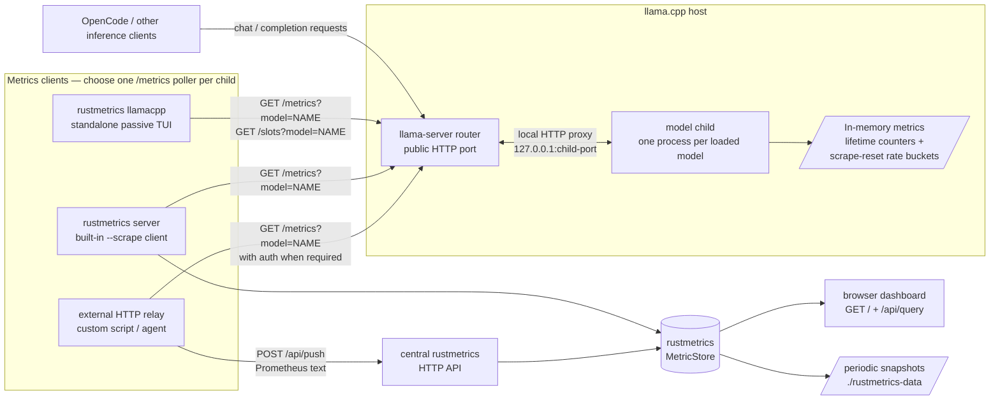

# llama.cpp metrics architecture

`llama-server` is a **pull-based metrics producer**. It accumulates metrics in
memory and exposes them over HTTP; it has no built-in Prometheus `remote_write`,
OpenTelemetry/OTLP, StatsD, Pushgateway, destination URL, or push-interval
setting. A client must therefore connect to llama.cpp and either store the
samples locally or relay them to a central server.

## Architecture



A standalone `llama-server --model ...` has the same flow without the router and
its local proxy. The TUI polls directly and keeps only its own chart history; it
does not send samples to the rustmetrics server.

## What happens inside llama.cpp

1. Real inference updates server-global counters and slot statistics in the
   model child. Monitoring does not require synthetic requests.
2. `--metrics` (or `LLAMA_ARG_ENDPOINT_METRICS=1`) enables the Prometheus HTTP
   handler. In router mode, the router normally passes this option to its
   children.
3. A client requests `/metrics?model=NAME`. The router proxies the request to
   that child; it does **not** aggregate all models or add a `model` label. Use
   one scrape target per loaded model.
4. The child queues a high-priority metrics task, snapshots its current state,
   renders Prometheus text, and resets the two inter-scrape throughput buckets.
   Lifetime counters are not reset.
5. `/slots?model=NAME` is a separate JSON endpoint. The TUI uses its per-task
   counters for live fallback rates; the generic Prometheus scraper does not
   ingest this JSON.

| Data | Examples | Semantics |
| --- | --- | --- |
| Lifetime counters | `llamacpp:prompt_tokens_total`, `llamacpp:tokens_predicted_total`, `llamacpp:n_decode_total` | Cumulative for the child process lifetime; reset when that child restarts |
| Inter-scrape rates | `llamacpp:prompt_tokens_seconds`, `llamacpp:predicted_tokens_seconds` | Processing-time-weighted averages since the previous scrape, not instantaneous wall-clock rates |
| Point-in-time gauges | `llamacpp:requests_processing`, `llamacpp:requests_deferred` | Current queue/slot state at the metrics snapshot |
| Slot progress | `n_prompt_tokens_processed`, `next_token.n_decoded`, `id_task` | Per-request JSON state used by the TUI for passive deltas |

The generation rate excludes the first token produced from the final prompt
batch's logits. Prediction statistics can also remain unflushed during a long
active request, so `requests_processing` may be nonzero while the generation
rate is still zero. The TUI's `/slots` fallback is therefore important for
in-flight visibility.

## Collection options

### Direct scrape into rustmetrics

Run the rustmetrics server anywhere that can reach an unauthenticated HTTP
metrics endpoint:

```sh
rustmetrics \
  --scrape 'http://127.0.0.1:8080/metrics' \
  --scrape-interval 5
```

For router mode, include and URL-encode the model query parameter, for example
`'http://127.0.0.1:7476/metrics?model=qwen38'`. The current built-in scraper
supports `http://` targets but does not yet support custom authentication
headers or HTTPS targets.

### Relay through a client

When the central server cannot reach llama.cpp, run a small client on a host
that can. The client performs an authenticated `GET /metrics?model=NAME` and
forwards the unchanged Prometheus text with:

```text
POST http://CENTRAL_RUSTMETRICS:9090/api/push
Content-Type: text/plain
```

This relay is external to llama.cpp and is not currently a separate rustmetrics
agent mode. Prometheus Agent or an OpenTelemetry Collector can similarly scrape
llama.cpp and forward to a backend that supports their `remote_write` or OTLP
protocols; rustmetrics itself accepts Prometheus text at `/api/push`, not those
protocols.

## Important constraints

- **Use only one `/metrics` poller per model child.** Every successful scrape
  resets the prompt and generation rate buckets. Running the TUI, rustmetrics
  scraper, and Prometheus against the same child makes their rate windows
  interfere. Lifetime counters do not have this problem.
- **Router health is not child health.** A healthy router can still return a
  proxy error if the selected child is unavailable.
- **Avoid accidental model loads.** Router monitoring requests can trigger
  autoload by default. The TUI selects only active models; external scrapers
  should target loaded models and use the router's `autoload=false` behavior
  where appropriate.
- **Authentication applies to monitoring endpoints.** `/health` is public, but
  `/metrics` and `/slots` require the configured bearer/API key.

## Upstream references

Verified against llama.cpp commit
[`e216f4ec8753`](https://github.com/ggml-org/llama.cpp/commit/e216f4ec8753e7317314e1ee01861b0230e583aa):

- [`--metrics` option](https://github.com/ggml-org/llama.cpp/blob/e216f4ec8753e7317314e1ee01861b0230e583aa/common/arg.cpp#L3640-L3646)
- [metric counters and rate buckets](https://github.com/ggml-org/llama.cpp/blob/e216f4ec8753e7317314e1ee01861b0230e583aa/tools/server/server-common.h#L492-L553)
- [snapshot rendering and bucket reset](https://github.com/ggml-org/llama.cpp/blob/e216f4ec8753e7317314e1ee01861b0230e583aa/tools/server/server-context.cpp#L3170-L3190)
- [Prometheus text renderer](https://github.com/ggml-org/llama.cpp/blob/e216f4ec8753e7317314e1ee01861b0230e583aa/tools/server/server-task.cpp#L1567-L1661)
- [router monitoring proxy](https://github.com/ggml-org/llama.cpp/blob/e216f4ec8753e7317314e1ee01861b0230e583aa/tools/server/server.cpp#L496-L523)
